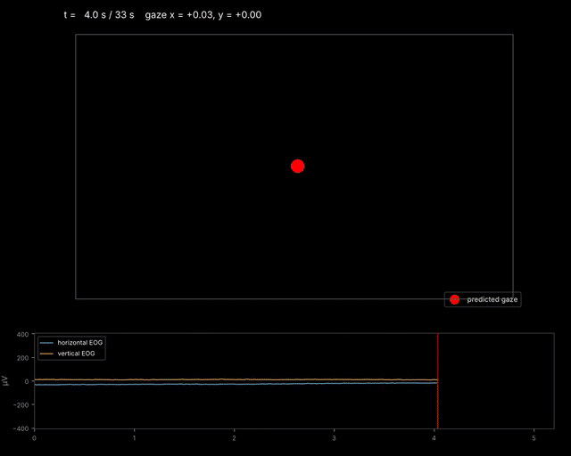

# EOG eye tracker

Predicts where a person is looking on a screen from their EOG (electrooculography), the small voltages that electrodes around the eyes pick up as the eyes move.



*The red dot is the model's prediction of where the person is looking. Underneath, the horizontal (blue) and vertical (orange) EOG signals drive it. The example data is simulated.*

## Quick test

You need Python 3.9 or newer.

Download the zip file and open it on any code editor (I use VS code). Then open a new terminal and type the following command:

```
pip install -r requirements.txt
python run_demo.py
```

On a Mac, type `pip3` and `python3` instead.

The result uses example EOG data (has been calibrated already). However, this application can use any EOG data to calibrate and therefore predict eye gaze (x,y coordinates).

`run_demo.py` trains the model on the example data the first time you run it, then opens the live animation. Keys: space = pause, left/right arrows = skip 5 s, q = quit.

To watch the other example recording (looking at corners, reading lines of text, following a circle), open `run_demo.py` and change `RECORDING = "test"` to `RECORDING = "reading"`.

## How it works

1. **Calibration** (`calibrate.py`). The person follows a moving red dot while their EOG is recorded. The script learns how the EOG relates to where the dot was. It cleans the signal (filtering, blink removal, drift correction), measures how far the eye lags the dot (~200 ms), fits a regression model, and saves it to `results/EOG_model_S01.json`.
2. **Prediction** (`eog_tracker.py`, `predict()`). For any new EOG recording, the model outputs the (x, y) screen position for every sample.
3. **Animation** (`animate_gaze.py`). Plays a recording back in real time with a red dot at the predicted gaze.

## Files

| File | What it is |
|---|---|
| `run_demo.py` | **Start here.** Trains (first time) and plays the animation |
| `eog_tracker.py` | The engine: signal cleaning, model, prediction |
| `calibrate.py` | Shows the moving-dot calibration and trains the model |
| `animate_gaze.py` | Red-dot animation of predicted gaze |
| `view_eog.py` | Plots the raw EOG in a recording |
| `example_predict.py` | Prints accuracy on the test recording, with a plot |
| `make_example_data.py` | Regenerates the simulated example data |
| `example_data/` | Simulated recordings: 4 electrodes (left, right, above, below the eye) + trigger, 500 Hz, microvolts |

## Running the parts yourself

```
python view_eog.py --eog example_data/EOG_example_reading.csv --eog-fs 500
python animate_gaze.py --eog example_data/EOG_example_test.npz
python calibrate.py --calib example_data/EOG_example_calib.npz --eog example_data/EOG_example_recording.npz --channels 0 1 2 3 --marker 4
python calibrate.py --demo
```

- `--eog`: which recording to use. Files are .npz, .mat or .csv; for a CSV, add `--eog-fs` with the sampling rate.
- `--channels`: which columns hold the electrodes, counting from 0. Use `0 1 2 3` for left, right, up, down electrodes, or `0 1` for ready-made horizontal and vertical channels.
- `--marker`: the column with the trigger pulse that marks when the moving dot started.
- `--demo`: runs a calibration with simulated EOG, no files needed.

## With real EOG

1. Start recording on your amplifier.
2. Run `python calibrate.py`. It shows a countdown, then about 40 s of moving dots for the person to follow with their eyes, head still.
3. Stop and save the recording. Give its path when the script asks, or pass it with `--eog`.

Then predict gaze on new recordings:

```python
import eog_tracker as et
model = et.EOGModel.load("results/EOG_model_S01.json")
xy, blink = model.predict(raw_eog, fs_in=500)
```

Accuracy is best when each recording starts and ends with ~2 s of looking at the screen centre. Pass those samples as `centre=` (or `--centre-first` / `--centre-last` in `animate_gaze.py`) so slow EOG drift can be removed.

Original MATLAB calibration paradigm by dcaro (2025); Python version with a rebuilt processing and prediction pipeline.
